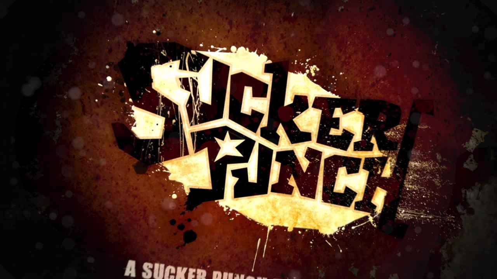
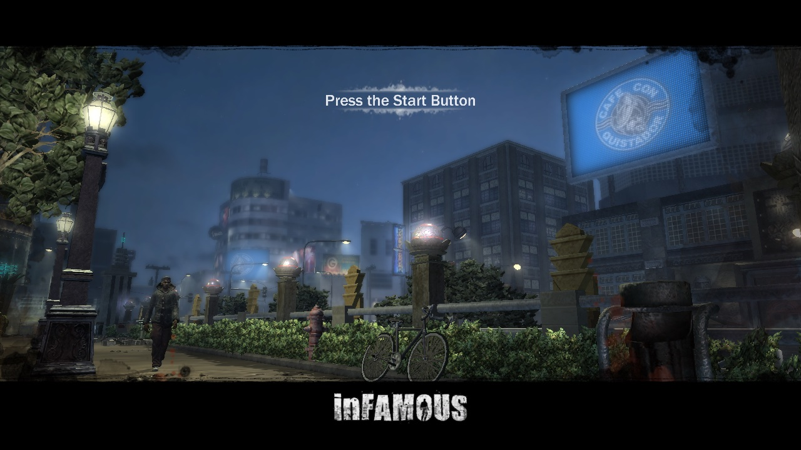
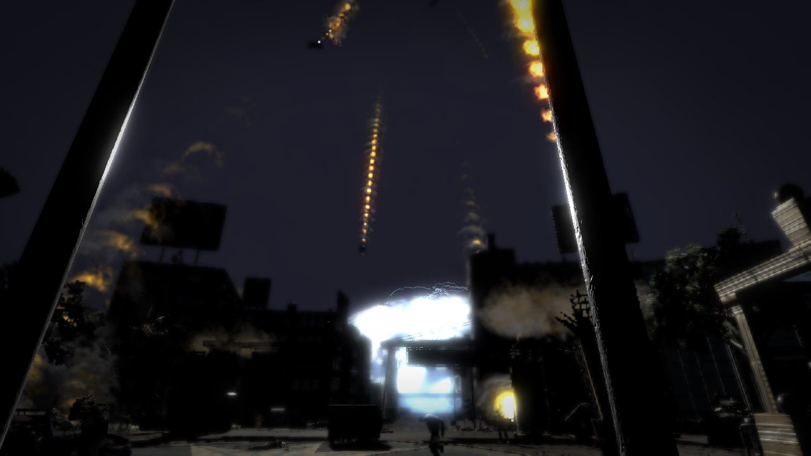
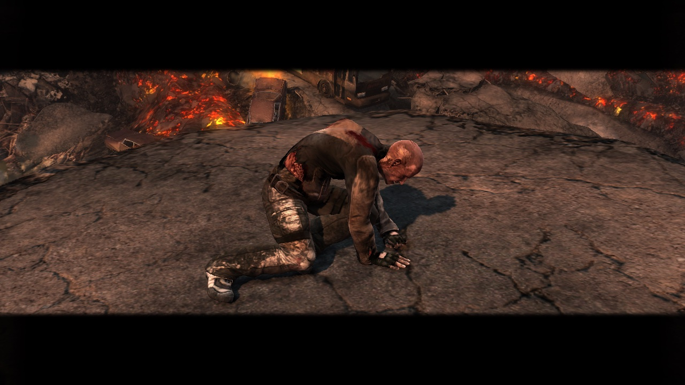
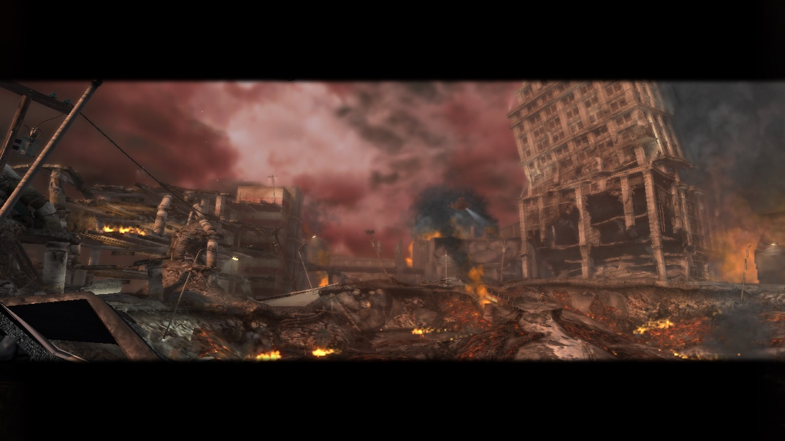
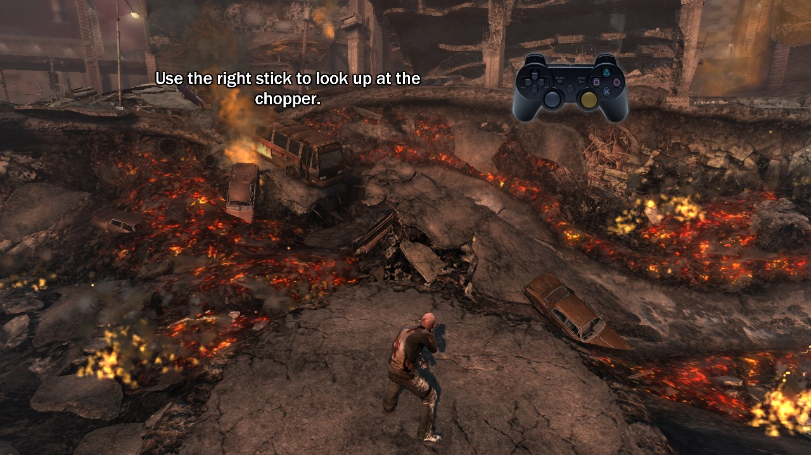

# inFAMOUS 1 — static recompilation for PC (macOS)

<a href="https://recomplauncher.com"><picture><source media="(prefers-color-scheme: dark)" srcset="https://recomplauncher.com/assets/press/launcher/badge-light.svg"></picture></a>

🌐 **English** · [Português (BR)](README.pt-BR.md)

A native port of **inFAMOUS** (PS3, digital release `NPUA80480`) to
**macOS/arm64**, built with static recompilation: the game's PowerPC and SPU
code is translated to C/C++ and compiled into a native executable, with
graphics on Metal. It is not an emulator.

**It boots, plays the studio logos and videos, reaches the 3D title screen,
and gets through the opening explosion to Cole in the tutorial** ("Use the
right stick to look up at the chopper"), at ~44 fps on Apple silicon in
headless runs. It is built from your own copy ([how](#building-from-source)).

| | |
| --- | --- |
| [](docs/screenshots/01-boot-sucker-punch-logo.jpg)<br>Boot: the studio logo | [](docs/screenshots/02-title-screen.jpg)<br>3D title screen |
| [](docs/screenshots/03-intro-cutscene.jpg)<br>The blast (in-engine cutscene) | [](docs/screenshots/04-cole-after-the-blast.jpg)<br>Cole after the blast |
| [](docs/screenshots/05-crater.jpg)<br>The crater | [](docs/screenshots/06-tutorial.jpg)<br>Gameplay: the first tutorial |

<sub>Frames from the port itself running on an Apple-silicon Mac (M4 Pro),
built from the player's own copy, at the game's 1280×720, captured headless
with `tools/capture.sh`. inFAMOUS © Sony Interactive Entertainment, developed
by Sucker Punch Productions; shown only to document the port.</sub>

> [!WARNING]
> **Early alpha.** The game runs from boot to the prologue tutorial, only on
> Apple silicon macOS. The full campaign and long sessions have not been
> validated. What is missing is in [ROADMAP.md](ROADMAP.md).

> **This repository contains no game data, no firmware, no Sony keys and
> nothing translated from them.** Everyone generates all of that locally from
> their own legitimate copy. A fan project, not affiliated with Sony
> Interactive Entertainment or Sucker Punch Productions.

Built on [ps3recomp](https://github.com/sp00nznet/ps3recomp) and, above all,
on [NoahBPeterson](https://github.com/NoahBPeterson/ps3recomp)'s **inFAMOUS 1
fork**, which brought the firmware LLE and the fixes that got the game running
on the Mac; the launcher and the shared runtime come from the
[inFAMOUS 2 port](https://github.com/erikomis/infamous2-recomp). See
[CREDITS.md](CREDITS.md).

## Status

| | |
| --- | --- |
| Boot, firmware LLE, SPURS, SPU job modules | ✅ |
| Studio logos, Bink videos, loading screens | ✅ |
| 3D title screen ("Press the Start Button") | ✅ |
| New game → opening explosion → Cole in the tutorial | ✅ |
| Performance | ✅ ~44 fps in the menu and cutscenes, headless, on Apple silicon (the console aimed at 30). Gameplay fps still to measure with `tools/profile_run.sh` |
| Anisotropic filtering up to 16× | ✅ checked on this game |
| Internal resolution, MetalFX, FXAA/SMAA, sharpening, colour | 🧪 through the shared runtime and the launcher, options mapped; no visual A/B per combination yet |
| Controller, keyboard and mouse, rumble | 🧪 adapted in the launcher, bindings tested; not every device combination |
| DualSense adaptive triggers, light bar, player lights, gyro aim | 🧪 unit-tested; not tried on a controller yet (quit Steam first) |
| In-game menu (F1 / Cmd+, / L3+R3) | 🧪 shared runtime, not checked on this game yet |
| Saves and trophies, saves manager in the app | ✅ local saves `BCUS98119_INFAMOUS_*` recognised, saves from inFAMOUS 2 rejected |
| The app: play, settings, controls, saves, logs | ✅ macOS bundle built, 72 tests pass, window starts the game |
| Rebuild from your copy in one command (`rebuild.py`) | ✅ checked from a clean install: lifts identical to the tested build, boots to the tutorial |
| The app: install / rebuild wizard | 🧪 turned on again, on top of the ported `rebuild.py`; not clicked through in the app yet |
| The app updates itself | ⏳ disabled in this distribution |
| GPU lighting and SSAO (the inFAMOUS 2 speed-up) | ⏳ needs this game's own work, see the roadmap |
| Ultrawide with fixed camera and HUD | ⏳ pending, option hidden |
| Whole game | ❓ not played past the tutorial yet |
| Linux and Windows | ⏳ planned |

Details and next steps in [ROADMAP.md](ROADMAP.md). The list of features
brought over from the inFAMOUS 2 port, with what was checked, is in
[PORT_FEATURES.md](PORT_FEATURES.md).

## Download and play

There is no release yet. You need an Apple-silicon Mac and your own copy of
inFAMOUS (the PSN release `NPUA80480`, for example installed in
[RPCS3](https://rpcs3.net) with its `.rap` licence).

1. Build the game from your copy with one command, see
   [Building from source](#building-from-source).
2. Open **Jogar inFAMOUS.command** to play straight away, or
   **Launcher inFAMOUS.command** for the app (graphics, controls, audio,
   mods and saves) and use its Play button.

## The app

[`launcher/`](launcher/README.md) is a desktop app (Tauri), adapted from the
inFAMOUS 2 one, with its own settings folder (`infamous1-recomp`) apart from the
second game's. English and Portuguese.

- **Graphics:** window, fullscreen or borderless, screen, vsync, gamma,
  anisotropic filtering (up to 16×), FXAA or SMAA, sharpening, MetalFX
  upscaling, internal resolution, colour adjustments.
- **Controls:** keyboard, mouse and controller, mouse camera, vibration,
  DualSense adaptive triggers; **audio** volume and output.
- **Saves:** list, back up, restore, import/export with RPCS3, `.zip`. It
  accepts `BCUS98119` / `NPUA80480` and rejects `BCUS98125` (inFAMOUS 2).
- **Trophies, logs and reports**, all local; nothing is uploaded.
- **Texture packs** and the shader cache manager.
- **Steam shortcut** (optional, only when asked in the interface).

The **install/rebuild** screen runs `infamous1-lle/tools/rebuild.py` (checked
from the command line; the screen itself not yet clicked through). Not enabled
for this game yet: GPU lighting and SSAO, removal of the inFAMOUS 2 shader
passes by hash, ultrawide camera/HUD fix and the self-update. See
[launcher/README.md](launcher/README.md).

## Known problems

- The full campaign and long sessions are not validated.
- Lighting and SSAO still run on the original SPU jobs, which costs fps; the
  job that does the lighting is being identified (candidate: image 209).
- Ultrawide aspect ratios stretch the HUD: the camera patch is limited to the
  inFAMOUS 2 EBOOT hash.
- The first time the game shows a new effect, its shader is translated on the
  render thread, which can stall for a moment; the cache makes it happen once.
- Windows and Linux are not supported yet.

## Work in progress

What is being worked on now (details in [ROADMAP.md](ROADMAP.md)):

- **Playing the whole story**, past the tutorial, and fixing what turns up.
- **GPU lighting and SSAO** for this game: find the lighting job, map its
  buffers and signals, compare with the Metal shaders of inFAMOUS 2.
- **Fixes for the original game's problems** (fps drops, aliasing, pop-in,
  camera, climbing, combat, AI, checkpoints, textures): the ones about image
  and speed come from the runtime's levers, the ones about game logic need
  patches in the translated code.
- **A release** of the app, and a click-through of its install screen.
- **Windows and Linux:** planned.

## Building from source

### What you need

- An Apple Silicon Mac (tested on an M4 Pro, macOS 27).
- A legitimate copy of inFAMOUS installed in [RPCS3](https://rpcs3.net), its
  license (`.rap`) and the PS3 firmware installed there.
- Xcode Command Line Tools and Homebrew:

```sh
brew install cmake ninja sdl2 glslang spirv-cross spirv-tools python@3.12
python3.12 -m venv .venv
```

### Building

```sh
git clone https://github.com/erikomis/infamous1-recomp.git
cd infamous1-recomp
tools/setup_toolkit.sh                        # toolkit in ./ps3recomp-fork
.venv/bin/pip install -r ps3recomp-fork/requirements.txt
```

`setup_toolkit.sh` clones NoahBPeterson's fork at `770660a` and applies
`infamous1-lle/patches/ps3recomp-fork-770660a-with-upstream-prs.patch` (the
inFAMOUS 2 port's toolkit patch plus this port's memory-window fix).

Then one command does the rest (decrypt, translate, compile), from your copy
and its licence:

```sh
python3 infamous1-lle/tools/rebuild.py --game "<RPCS3>/dev_hdd0/game/NPUA80480" --rap <UP9000-NPUA80480...rap>
```

`--dry-run` lists the steps and checks every prerequisite first. By default
the EBOOT and the firmware are decrypted with RPCS3; without RPCS3, pass your
own key file (scetool format) with `--keys KEYFILE`, and the firmware as
Sony's `PS3UPDAT.PUP` with `--firmware PS3UPDAT.PUP`. No keys ship with this
repository. The output goes to `--out` (default
`~/Library/Application Support/infamous1-recomp/install`); `--toolkit DIR`
uses a patched checkout you already have. The manual recipe is in
[`infamous1-lle/README.md`](infamous1-lle/README.md#rebuilding).

On an M4 Pro, from a clean install (2026-11-11), translating took about 40 s
and compiling about 2 minutes. The result was checked against the
tested build: the firmware, PPU and SPU lifts came out byte for byte the same,
and the binary boots to the tutorial.

CI (`.github/workflows/`) builds the launcher for macOS, Windows and Linux and
checks the Python and shell tools on every change; no game data is involved.

## Playing from the terminal

```sh
cd infamous1-lle
./run.sh
```

`run.sh` sets the memory window (`PS3_MEM_ALLOC_SIZE=0x30000000`) and the HDD
boot path (`/dev_hdd0/game/NPUA80480/USRDIR/EBOOT.BIN`) the game needs. A
controller (DualSense tested) works out of the box; keyboard and mouse add on
top of it, with the same layout as the inFAMOUS 2 port.

On a DualSense the triggers get a feel (`PS3_PAD_ADAPTIVE=0`, or the
launcher's Controls switch, turns it off). The trigger you fire bolts with,
the one the controls map binds to R1 (the right one when R1 is on neither,
as in the default map, where the triggers are L2/R2), clicks like a gun's:
it reads as pressed at the click, about half way (`PS3_PAD_FIRE_AT=<10-90>`),
and buzzes with the motors while you fire. The other trigger, aiming with L1
bound to it, has a light resistance. Both are set free when the game closes.
The game logs `adaptive triggers on (fires with the right trigger at 50%)`.

The rest of the DualSense (and a DualShock 4's light bar and gyro): the
player lights show the port; the light bar is Cole's electric blue
(`PS3_PAD_LIGHT=<RRGGBB>|off`) and glows red while the game runs the motors
(`PS3_PAD_LIGHT_HIT=0` keeps it steady); gyro aim (`PS3_PAD_GYRO=<percent>`,
off by default) turns the camera while you hold aim, L1 or whatever the map
binds to it (`PS3_PAD_GYRO_MODE=always` without holding). All of it is in the
launcher's Controls. **Quit Steam first:** with Steam Input on it takes over
the DualSense and the triggers and the light bar stay off (rumble still
works); the game logs a line when Steam is running.


| Key | PS3 |
| --- | --- |
| W A S D | left stick |
| I J K L or mouse | right stick (camera) |
| Arrow keys | D-pad |
| Space | ✕ |
| Q / E / R | ○ / □ / △ |
| U / O | L1 / R1 |
| Y / P | L2 / R2 |
| G / H | L3 / R3 |
| Return / Tab | START / SELECT |

On the title screen **START** (`0x0008`) moves on; ✕ does not.

Useful variables, shared with the other ports of this toolkit:

| Variable | What it does |
| --- | --- |
| `PS3_ANISO=2\|4\|8\|16` | anisotropic filtering (only mipmapped textures). Default off |
| `PS3_AA=fxaa` / `smaa` | anti-aliasing on the 1280×720 image |
| `PS3_RES_SCALE=1.5\|2\|3` | internal resolution (1080p / 1440p / 4K) |
| `PS3_UPSCALE=metalfx` | MetalFX spatial upscaling to the window |
| `PS3_SHARPEN=<0..1>` | contrast-adaptive sharpening |
| `PS3_WINDOW_MODE=windowed\|fullscreen\|borderless` | how the game opens |
| `PS3_MEM_ALLOC_SIZE=<hex>` | the allocator window, 16 MB to 3 GB (default 256 MB; `run.sh` uses 768 MB) |
| `PS3_ASPECT=21:9` | ultrawide; **pending for this game**, the HUD is not fixed |

For headless tests: `tools/capture.sh <name> <seconds>` saves a PNG of the
frame every 10 s, `PAD_SCRIPT="145:0x0008"` presses START at 145 s, and
`tools/play_prologue.sh` runs the title-to-tutorial path in one command.
`tools/profile_run.sh` reports fps per period and the hottest code.

## Fixes made here

- **Memory window (`sys_memory`):** the toolkit's allocator ended 256 MB after
  its base, so the boot's scan of the streaming cache ran out of memory and the
  audio/streaming init never finished. The end of the window is now
  `PS3_MEM_ALLOC_SIZE`. This is what got the game past the boot.
- **Boot from HDD (`cellGame`):** `runtime_overrides/cellGame.c` reads
  `CATEGORY` from `PARAM.SFO` (`HG` here) and reports an HDD boot instead of a
  disc one.
- **Recursive cleanup:** `func_00105550` did a recursive clean-up over the
  install while `cellFsUnlink` / `cellFsRmdir` were no-ops, reopening
  `sounds/music` tens of thousands of times; found with the file-system trace.
- **SPU returns:** fixes for SPU returns in the translated job modules
  (`relift_spu_returns.py`).
- **Game patches** (`game_patches.cpp`) are filtered by the program header
  hash (`PPU-<sha1>`), so an inFAMOUS 2 patch never applies to this EBOOT.

## Layout

| Folder | What it is |
| ------ | ---------- |
| [`infamous1-lle/`](infamous1-lle) | **Current port.** inFAMOUS 1 fork + firmware LLE: `main.cpp`, `stubs.cpp`, `run.sh`, runtime overrides, SPU/PPU tools. |
| `infamous1/` | Local game files (`vfs/`), never published. |
| [`launcher/`](launcher/README.md) | The desktop app (Tauri): play, settings, saves. |
| `tools/` | `setup_toolkit.sh` clones the fork at the commit in use and applies the patch; job-module lifting scripts. |
| `docs/screenshots/` | The gallery at the top of this page. |
| [`NOTES.md`](NOTES.md) | Working notes and evidence, in Portuguese. |
| [`PORT_FEATURES.md`](PORT_FEATURES.md) | What came from the inFAMOUS 2 port and what was checked. |

## License

Code in this repository: MIT ([LICENSE](LICENSE)). The toolkit and the fork
are MIT by their authors. inFAMOUS © Sony Computer Entertainment America
LLC, developed by Sucker Punch Productions; this project is not affiliated
with Sony.
