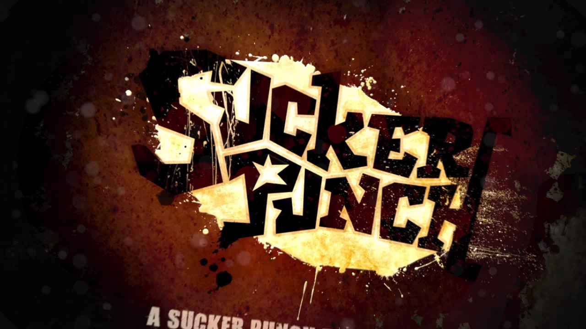
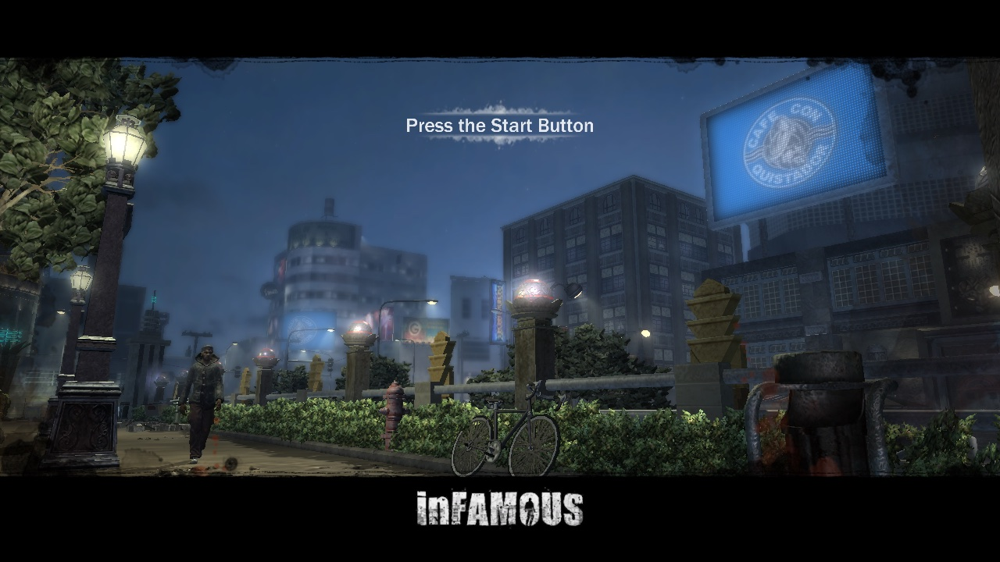
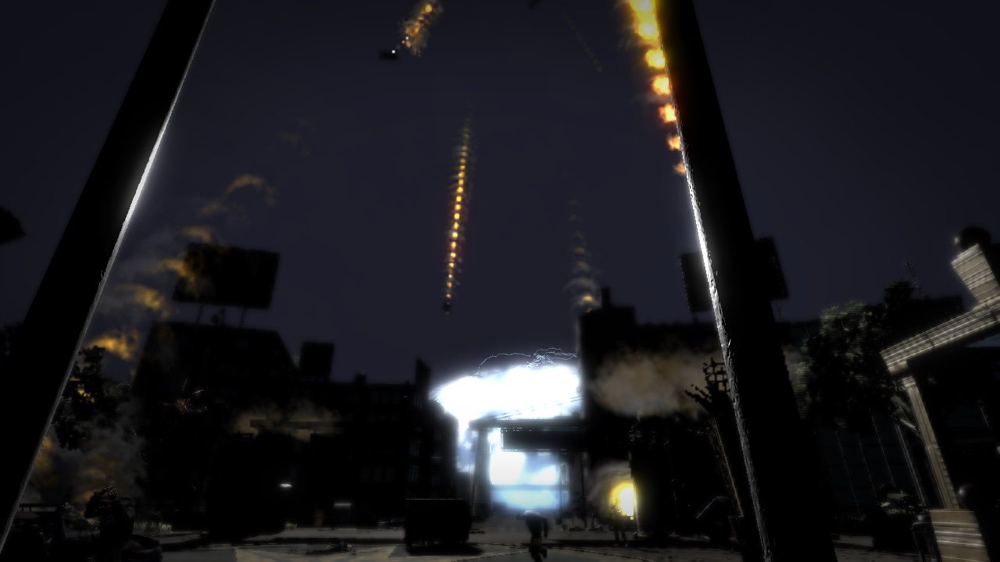
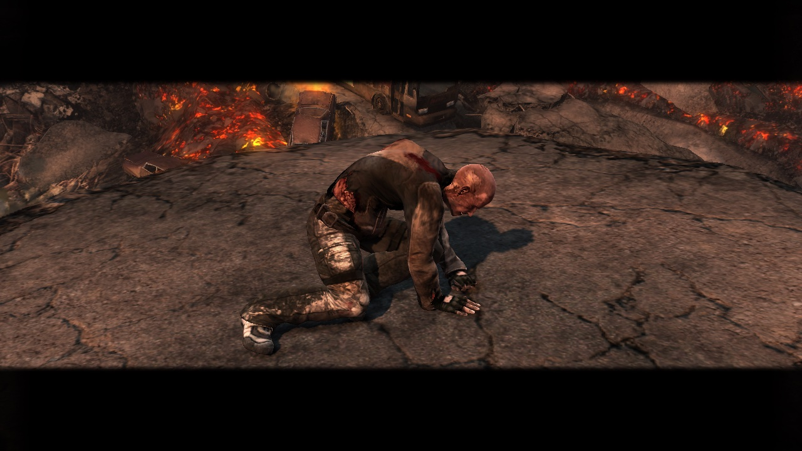
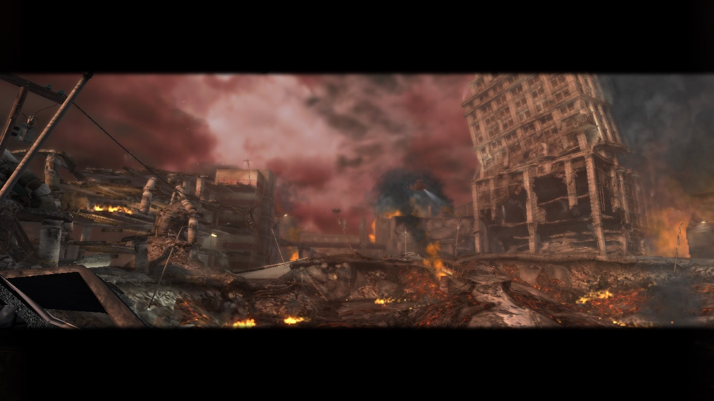
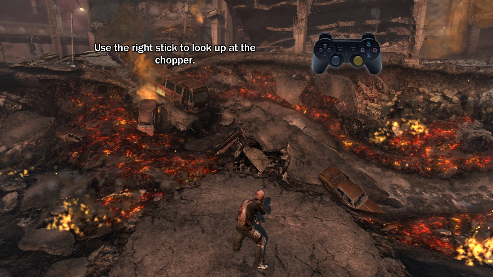

# inFAMOUS 1 — recompilação estática para PC (macOS)

<a href="https://recomplauncher.com"><picture><source media="(prefers-color-scheme: dark)" srcset="https://recomplauncher.com/assets/press/launcher/badge-light.svg"></picture></a>

🌐 [English](README.md) · **Português (BR)**

Um port nativo do **inFAMOUS** (PS3, versão digital `NPUA80480`) para
**macOS/arm64**, feito por recompilação estática: o código PowerPC e SPU do
jogo é traduzido para C/C++ e compilado num executável nativo, com gráficos em
Metal. Não é um emulador.

**Ele dá boot, mostra os logos e vídeos, chega à tela inicial 3D e passa da
explosão de abertura até o Cole no tutorial** ("Use the right stick to look up
at the chopper"), a ~44 fps em Apple silicon em execuções headless. Ele é
compilado a partir da sua própria cópia ([como](#compilando-a-partir-do-código)).

| | |
| --- | --- |
| [](docs/screenshots/01-boot-sucker-punch-logo.jpg)<br>Boot: o logo do estúdio | [](docs/screenshots/02-title-screen.jpg)<br>Tela inicial 3D |
| [](docs/screenshots/03-intro-cutscene.jpg)<br>A explosão (cutscene no motor do jogo) | [](docs/screenshots/04-cole-after-the-blast.jpg)<br>Cole depois da explosão |
| [](docs/screenshots/05-crater.jpg)<br>A cratera | [](docs/screenshots/06-tutorial.jpg)<br>Gameplay: o primeiro tutorial |

<sub>Frames do próprio port rodando num Mac com Apple silicon (M4 Pro),
compilado a partir da cópia do jogador, na resolução do jogo (1280×720),
capturados headless com `tools/capture.sh`. inFAMOUS © Sony Interactive
Entertainment, desenvolvido pela Sucker Punch Productions; mostrado só para
documentar o port.</sub>

> [!WARNING]
> **Alpha inicial.** O jogo roda do boot até o tutorial do prólogo, só em macOS
> com Apple silicon. A campanha completa e sessões longas não foram validadas.
> O que falta está em [ROADMAP.pt-BR.md](ROADMAP.pt-BR.md).

> **Este repositório não contém dados do jogo, firmware, chaves da Sony nem
> nada traduzido a partir deles.** Cada pessoa gera tudo isso localmente, a
> partir da sua própria cópia legítima. Projeto de fã, sem vínculo com a Sony
> Interactive Entertainment nem com a Sucker Punch Productions.

Construído sobre o [ps3recomp](https://github.com/sp00nznet/ps3recomp) e,
principalmente, sobre o **fork do inFAMOUS 1** do
[NoahBPeterson](https://github.com/NoahBPeterson/ps3recomp), que trouxe o LLE do
firmware e as correções que fizeram o jogo rodar no Mac; o launcher e o runtime
compartilhado vêm do [port do inFAMOUS 2](https://github.com/erikomis/infamous2-recomp).
Veja [CREDITS.pt-BR.md](CREDITS.pt-BR.md).

## Estado

| | |
| --- | --- |
| Boot, LLE do firmware, SPURS, módulos de job SPU | ✅ |
| Logos dos estúdios, vídeos Bink, telas de carregamento | ✅ |
| Tela inicial 3D ("Press the Start Button") | ✅ |
| Novo jogo → explosão de abertura → Cole no tutorial | ✅ |
| Desempenho | ✅ ~44 fps no menu e nas cutscenes, headless, em Apple silicon (o console mirava 30). O fps em gameplay ainda será medido com `tools/profile_run.sh` |
| Filtragem anisotrópica até 16× | ✅ verificada neste jogo |
| Resolução interna, MetalFX, FXAA/SMAA, nitidez, cor | 🧪 pelo runtime compartilhado e pelo launcher, opções mapeadas; sem A/B visual por combinação ainda |
| Controle, teclado e mouse, vibração | 🧪 adaptados no launcher, bindings testados; nem todas as combinações de dispositivos |
| Gatilhos adaptáveis, barra de luz, luzes de jogador e mira por giroscópio do DualSense | 🧪 testados em unidade; ainda não provados num controle (feche a Steam antes) |
| Menu no jogo (F1 / Cmd+, / L3+R3) | 🧪 runtime compartilhado, ainda não verificado neste jogo |
| Saves e troféus, gerenciador de saves no app | ✅ saves locais `BCUS98119_INFAMOUS_*` reconhecidos, saves do inFAMOUS 2 rejeitados |
| O app: jogar, ajustes, controles, saves, logs | ✅ bundle macOS gerado, 72 testes passam, a janela inicia o jogo |
| Rebuild a partir da sua cópia num comando (`rebuild.py`) | ✅ verificado a partir de uma instalação limpa: lifts idênticos ao build testado, boota até o tutorial |
| O app: assistente de instalação / rebuild | 🧪 religado, sobre o `rebuild.py` portado; ainda não testado clicando no app |
| O app se atualiza sozinho | ⏳ desativado nesta distribuição |
| Iluminação e SSAO na GPU (o ganho de velocidade do inFAMOUS 2) | ⏳ exige trabalho próprio deste jogo, veja o roadmap |
| Ultrawide com câmera e HUD corrigidos | ⏳ pendente, opção oculta |
| Jogo inteiro | ❓ ainda não jogado além do tutorial |
| Linux e Windows | ⏳ planejado |

Detalhes e próximos passos em [ROADMAP.pt-BR.md](ROADMAP.pt-BR.md). A lista de
recursos trazidos do port do inFAMOUS 2, com o que foi verificado, está em
[PORT_FEATURES.md](PORT_FEATURES.md).

## Baixar e jogar

Ainda não há release. Você precisa de um Mac com Apple silicon e da sua
própria cópia do inFAMOUS (a versão PSN `NPUA80480`, por exemplo instalada no
[RPCS3](https://rpcs3.net) com a licença `.rap`).

1. Compile o jogo a partir da sua cópia com um comando, veja
   [Compilando a partir do código](#compilando-a-partir-do-código).
2. Abra **Jogar inFAMOUS.command** para jogar direto, ou
   **Launcher inFAMOUS.command** para o app (gráficos, controles, áudio, mods
   e saves) e use o botão Jogar.

## O app

[`launcher/`](launcher/README.md) é um app de desktop (Tauri), adaptado do
inFAMOUS 2, com pasta de configurações própria (`infamous1-recomp`), separada
da do segundo jogo. Em português e inglês.

- **Gráficos:** janela, tela cheia ou sem bordas, monitor, vsync, gama, filtragem
  anisotrópica (até 16×), FXAA ou SMAA, nitidez, upscaling MetalFX, resolução
  interna, ajustes de cor.
- **Controles:** teclado, mouse e controle, câmera no mouse, vibração,
  gatilhos adaptáveis do DualSense; **áudio** com volume e saída.
- **Saves:** listar, fazer backup, restaurar, importar/exportar com o RPCS3,
  `.zip`. Aceita `BCUS98119` / `NPUA80480` e rejeita `BCUS98125` (inFAMOUS 2).
- **Troféus, logs e relatórios**, tudo local; nada é enviado.
- **Pacotes de textura** e gerenciador do cache de shaders.
- **Atalho do Steam** (opcional, só quando pedido na interface).

A tela de **instalação/rebuild** roda o `infamous1-lle/tools/rebuild.py`
(verificado pela linha de comando; a tela em si ainda não foi testada
clicando). Ainda não habilitados neste jogo: iluminação e SSAO na GPU, remoção
de passes de shader do inFAMOUS 2 por hash, correção de câmera/HUD ultrawide e
a atualização automática. Veja [launcher/README.md](launcher/README.md).

## Problemas conhecidos

- A campanha completa e sessões longas não estão validadas.
- Iluminação e SSAO ainda rodam nos jobs SPU originais, o que custa fps; o job
  que faz a iluminação está sendo identificado (candidato: image 209).
- Proporções ultrawide esticam o HUD: o patch de câmera é limitado ao hash do
  EBOOT do inFAMOUS 2.
- Na primeira vez que o jogo mostra um efeito novo, o shader é traduzido na
  thread de render, o que pode travar por um instante; o cache faz isso
  acontecer uma vez só.
- Windows e Linux ainda não são suportados.

## Em andamento

O que está sendo feito agora (detalhes em [ROADMAP.pt-BR.md](ROADMAP.pt-BR.md)):

- **Jogar a história inteira**, além do tutorial, e corrigir o que aparecer.
- **Iluminação e SSAO na GPU** para este jogo: achar o job de iluminação,
  mapear buffers e sinais, comparar com os shaders Metal do inFAMOUS 2.
- **Correções dos problemas do jogo original** (quedas de fps, aliasing, pop-in,
  câmera, escalada, combate, IA, checkpoints, texturas): os de imagem e
  velocidade saem das alavancas do runtime, os de lógica exigem patches no
  código traduzido.
- **Um release** do app, e testar a tela de instalação clicando nela.
- **Windows e Linux:** planejado.

## Compilando a partir do código

### O que você precisa

- Um Mac com Apple Silicon (testado num M4 Pro, macOS 27).
- Uma cópia legítima do inFAMOUS instalada no [RPCS3](https://rpcs3.net), com a
  licença (`.rap`) e o firmware do PS3 instalados nele.
- Xcode Command Line Tools e Homebrew:

```sh
brew install cmake ninja sdl2 glslang spirv-cross spirv-tools python@3.12
python3.12 -m venv .venv
```

### Compilando

```sh
git clone https://github.com/erikomis/infamous1-recomp.git
cd infamous1-recomp
tools/setup_toolkit.sh                        # toolkit em ./ps3recomp-fork
.venv/bin/pip install -r ps3recomp-fork/requirements.txt
```

O `setup_toolkit.sh` clona o fork do NoahBPeterson no `770660a` e aplica o
`infamous1-lle/patches/ps3recomp-fork-770660a-with-upstream-prs.patch` (o patch
do toolkit do port do inFAMOUS 2 mais a correção da janela de memória deste
port).

Depois um comando faz o resto (decifrar, traduzir, compilar), a partir da sua
cópia e da licença dela:

```sh
python3 infamous1-lle/tools/rebuild.py --game "<RPCS3>/dev_hdd0/game/NPUA80480" --rap <UP9000-NPUA80480...rap>
```

O `--dry-run` lista os passos e confere cada pré-requisito antes. Por padrão o
EBOOT e o firmware são decifrados com o RPCS3; sem o RPCS3, passe seu próprio
arquivo de chaves (formato scetool) com `--keys ARQUIVO`, e o firmware como o
`PS3UPDAT.PUP` da Sony com `--firmware PS3UPDAT.PUP`. Nenhuma chave vem neste
repositório. A saída vai para `--out` (padrão
`~/Library/Application Support/infamous1-recomp/install`); `--toolkit PASTA`
usa um checkout já com o patch. A receita manual está em
[`infamous1-lle/README.md`](infamous1-lle/README.md#rebuilding).

Num M4 Pro, a partir de uma instalação limpa (2026-11-11), traduzir levou uns
40 s e compilar uns 2 minutos. O resultado foi comparado com o build testado:
os lifts de firmware, PPU e SPU saíram idênticos byte a byte, e o binário
boota até o tutorial.

O CI (`.github/workflows/`) compila o launcher para macOS, Windows e Linux e
confere as ferramentas Python e shell a cada mudança; nenhum dado do jogo é
usado.

## Jogando pelo terminal

```sh
cd infamous1-lle
./run.sh
```

O `run.sh` define a janela de memória (`PS3_MEM_ALLOC_SIZE=0x30000000`) e o
caminho de boot HDD (`/dev_hdd0/game/NPUA80480/USRDIR/EBOOT.BIN`) que o jogo
precisa. Um controle (DualSense testado) funciona direto; teclado e mouse
somam por cima, com o mesmo mapa do port do inFAMOUS 2.

No DualSense os gatilhos ganham uma sensação (`PS3_PAD_ADAPTIVE=0`, ou a
chave em Controles no launcher, desliga). O gatilho com que você dispara
raios, o que o mapa de controles liga ao R1 (o direito quando o R1 não está
em nenhum, como no mapa padrão, em que os gatilhos são L2/R2), tem um clique
de gatilho de arma: conta como apertado no clique, mais ou menos na metade
(`PS3_PAD_FIRE_AT=<10-90>`), e vibra com os motores enquanto você dispara. O
outro gatilho, de mirar com o L1 ligado a ele, tem uma resistência leve. Os
dois ficam livres quando o jogo fecha. O jogo registra
`adaptive triggers on (fires with the right trigger at 50%)` no log.

O resto do DualSense (e a barra de luz e o giroscópio de um DualShock 4): as
luzes de jogador mostram a porta; a barra de luz é o azul elétrico do Cole
(`PS3_PAD_LIGHT=<RRGGBB>|off`) e fica vermelha enquanto o jogo liga os
motores (`PS3_PAD_LIGHT_HIT=0` a deixa fixa); a mira por giroscópio
(`PS3_PAD_GYRO=<porcentagem>`, desligada por padrão) gira a câmera enquanto
você segura a mira, o L1 ou o que o mapa liga a ele (`PS3_PAD_GYRO_MODE=always`
sem segurar). Tudo fica em Controles no launcher. **Feche a Steam antes:**
com o Steam Input ligado ela toma o DualSense e os gatilhos e a luz ficam
desligados (a vibração continua); o jogo registra uma linha quando a Steam
está aberta.

**Batimento com pouca vida** (qualquer controle com vibração): abaixo de 35%
da vida do Cole o controle pulsa como um coração, de 70 a 140 batidas por
minuto conforme a vida acaba, e a barra de luz pulsa em vermelho junto; para
quando ele se recupera ou morre, e em menus e telas de carregamento
(`PS3_HEARTBEAT=0` ou a chave no launcher desliga, `PS3_HEARTBEAT_AT=<5-90>`
muda o limite). A imagem do próprio jogo fica em preto e branco mais ou menos
no mesmo ponto. Como a vida do Cole foi achada:
[`infamous1-lle/notes/health/`](infamous1-lle/notes/health/README.md).


| Tecla | PS3 |
| --- | --- |
| W A S D | analógico esquerdo |
| I J K L ou mouse | analógico direito (câmera) |
| Setas | D-pad |
| Espaço | ✕ |
| Q / E / R | ○ / □ / △ |
| U / O | L1 / R1 |
| Y / P | L2 / R2 |
| G / H | L3 / R3 |
| Return / Tab | START / SELECT |

Na tela inicial, **START** (`0x0008`) avança; ✕ não.

Variáveis úteis, compartilhadas com os outros ports deste toolkit:

| Variável | O que faz |
| --- | --- |
| `PS3_ANISO=2\|4\|8\|16` | filtragem anisotrópica (só texturas com mipmaps). Padrão desligado |
| `PS3_AA=fxaa` / `smaa` | anti-aliasing na imagem de 1280×720 |
| `PS3_RES_SCALE=1.5\|2\|3` | resolução interna (1080p / 1440p / 4K): todos os alvos de cor e profundidade, sombras e reflexos incluídos. Acima dos pixels da janela vira supersampling: cada quadro é reduzido para a janela com um filtro Lanczos, contando todos os pixels (`PS3_DOWNSCALE=0`: a redução antiga) |
| `PS3_UPSCALE=metalfx` | upscaling espacial MetalFX até a janela |
| `PS3_SHARPEN=<0..1>` | nitidez adaptativa ao contraste |
| `PS3_WINDOW_MODE=windowed\|fullscreen\|borderless` | como o jogo abre |
| `PS3_MEM_ALLOC_SIZE=<hex>` | a janela do alocador, de 16 MB a 3 GB (padrão 256 MB; o `run.sh` usa 768 MB) |
| `PS3_ASPECT=21:9` | ultrawide; **pendente neste jogo**, o HUD não está corrigido |

Para testes headless: `tools/capture.sh <nome> <segundos>` salva um PNG do
frame a cada 10 s, `PAD_SCRIPT="145:0x0008"` aperta START aos 145 s, e
`tools/play_prologue.sh` faz o caminho da tela inicial ao tutorial num comando
só. `tools/profile_run.sh` informa o fps por período e o código mais quente.

## Correções feitas aqui

- **Janela de memória (`sys_memory`):** o alocador do toolkit terminava 256 MB
  depois da base, então a varredura do cache de streaming no boot acabava a
  memória e o init de áudio/streaming nunca concluía. O fim da janela agora é
  `PS3_MEM_ALLOC_SIZE`. Foi isso que passou o jogo do boot.
- **Boot por HDD (`cellGame`):** `runtime_overrides/cellGame.c` lê o `CATEGORY`
  do `PARAM.SFO` (`HG` aqui) e informa boot HDD em vez de disco.
- **Limpeza recursiva:** `func_00105550` fazia uma limpeza recursiva sobre a
  instalação enquanto `cellFsUnlink` / `cellFsRmdir` eram no-ops, reabrindo
  `sounds/music` dezenas de milhares de vezes; achado com o trace do sistema de
  arquivos.
- **Retornos SPU:** correções dos retornos SPU nos módulos de job traduzidos
  (`relift_spu_returns.py`).
- **Patches do jogo** (`game_patches.cpp`) são filtrados pelo hash do program
  header (`PPU-<sha1>`), então um patch do inFAMOUS 2 nunca é aplicado neste
  EBOOT.

## Estrutura

| Pasta | O que é |
| ----- | ------- |
| [`infamous1-lle/`](infamous1-lle) | **Port atual.** Fork do inFAMOUS 1 + LLE do firmware: `main.cpp`, `stubs.cpp`, `run.sh`, overrides de runtime, ferramentas SPU/PPU. |
| `infamous1/` | Arquivos locais do jogo (`vfs/`), nunca publicados. |
| [`launcher/`](launcher/README.md) | O app de desktop (Tauri): jogar, ajustes, saves. |
| `tools/` | `setup_toolkit.sh` clona o fork no commit em uso e aplica o patch; scripts de lift dos módulos de job. |
| `docs/screenshots/` | A galeria no topo desta página. |
| [`NOTES.md`](NOTES.md) | Notas de trabalho e evidências. |
| [`PORT_FEATURES.md`](PORT_FEATURES.md) | O que veio do port do inFAMOUS 2 e o que foi verificado. |

## Licença

Código deste repositório: MIT ([LICENSE](LICENSE)). O toolkit e o fork são MIT
pelos seus autores. inFAMOUS © Sony Computer Entertainment America LLC,
desenvolvido pela Sucker Punch Productions; este projeto não tem vínculo com a
Sony.
